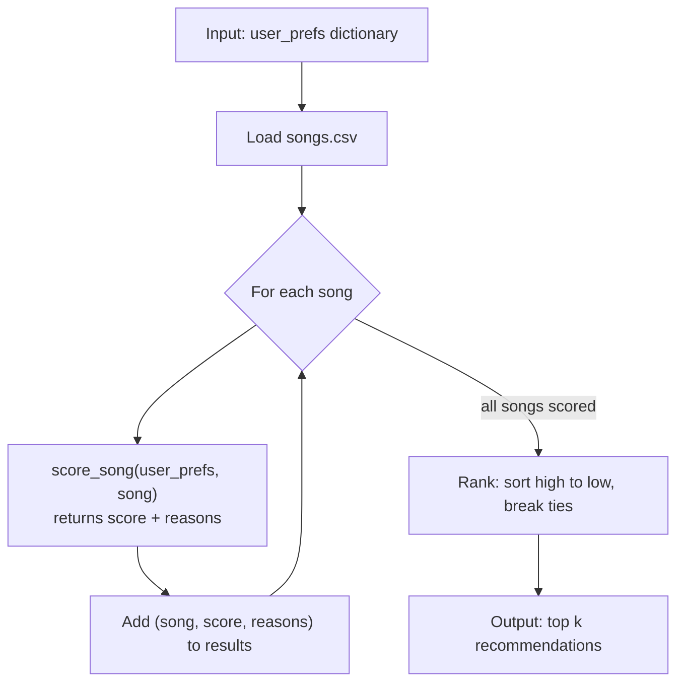

# 🎵 Music Recommender Simulation

## Project Summary

In this project you will build and explain a small music recommender system.

Your goal is to:

- Represent songs and a user "taste profile" as data
- Design a scoring rule that turns that data into recommendations
- Evaluate what your system gets right and wrong
- Reflect on how this mirrors real world AI recommenders

Replace this paragraph with your own summary of what your version does.

---

## How The System Works

Real-world music recommenders often combine song attributes with listening behavior, such as plays, skips, and saves, to predict what a listener may enjoy and rank those options. This project uses a simpler content-based approach: it compares each song's genre and mood with the user's preferences, and scores how close each numeric feature (energy, tempo, valence, danceability, acousticness) is to the user's target. A weighted score prioritizes the closest matches; unlike larger systems, this version does not learn from listening history or other users.

Each `Song` stores `id`, `title`, `artist`, `genre`, `mood`, `energy`, `tempo_bpm`, `valence`, `danceability`, and `acousticness`. The user's taste profile is a dictionary with a favorite genre, a favorite mood, and a target value for each numeric feature. The scoring rule uses all of these features: genre and mood are matched as labels, and every numeric feature is scored by how close it is to the user's target value.

### Implementation Plan

1. **Load the data.** `load_songs()` reads `data/songs.csv` with `csv.DictReader` and converts the numeric columns (`energy`, `tempo_bpm`, `valence`, `danceability`, `acousticness`) from text to numbers.
2. **Define the taste profile.** Store the user's preferences as a `user_prefs` dictionary (see below).
3. **Score one song.** `score_song(user_prefs, song)` applies the Algorithm Recipe and returns `(score, reasons)`.
4. **Score and rank every song.** `recommend_songs(user_prefs, songs, k)` loops over all songs, scores each one, sorts the results, and returns the top `k` as `(song, score, explanation)`.
5. **Connect the class version.** `Recommender.recommend()` and `Recommender.explain_recommendation()` reuse the same scoring logic so the tests in `tests/test_recommender.py` pass.
6. **Test and compare.** Check the results against the expected top 5 below, then run 3–4 different profiles (for example "chill lofi", "intense rock", "happy pop") to see whether the rankings make sense for each one.

### Taste Profile

The recommender compares every song against a user profile stored as a dictionary. The example profile is a "Late-Night Study Session" listener. The numeric targets are roughly the average of the three lofi songs in the dataset.

```python
user_prefs = {
    "favorite_genre": "lofi",
    "favorite_mood": "focused",
    "target_energy": 0.40,
    "target_tempo": 78,
    "target_valence": 0.58,
    "target_danceability": 0.60,
    "target_acousticness": 0.78,
}
```

### Algorithm Recipe

**Scoring rule (one song, 0–100 points)**

| Feature | Max points | How it is scored |
|---|---|---|
| Mood | 30 | 30 for an exact match, 15 for a mood in the same cluster, 0 otherwise |
| Genre | 20 | 20 for an exact match, 0 otherwise |
| Energy | 20 | `(1 - abs(song - target)) * 20` |
| Valence | 10 | `(1 - abs(song - target)) * 10` |
| Danceability | 8 | `(1 - abs(song - target)) * 8` |
| Acousticness | 7 | `(1 - abs(song - target)) * 7` |
| Tempo | 5 | `(1 - abs(song_bpm - target_bpm) / 120) * 5` |

Rules that apply to every numeric feature:

- **Closeness, not size.** A song scores highest when it is near the target, whether it is above or below it.
- **Tempo is normalized.** BPM is divided by 120 so it is on the same 0–1 scale as the other features.
- **No negative points.** Any closeness value below 0 is set to 0.
- **Reasons are recorded.** Each rule that awards points adds a short reason, such as `"mood match: focused"`, to explain the recommendation.

**Mood clusters (partial credit)**

Most moods appear only once or twice in the dataset, so exact matching alone would give almost every song 0 mood points. Similar moods are grouped so a near match earns half credit:

| Cluster | Moods |
|---|---|
| Calm | chill, relaxed, peaceful, focused, dreamy, reflective |
| Happy | happy, uplifting, euphoric, celebratory, carefree, playful, whimsical, mischievous |
| Intense | intense, angry, aggressive, anxious, rebellious, overwhelmed |
| Energetic | energetic, confident, determined, adventurous |
| Romantic | romantic, passionate |
| Longing | sad, melancholic, yearning, nostalgic |
| Moody | moody, mysterious, uncertain |

Mood (30) is weighted above genre (20) because mood describes how the listener wants to feel, and listeners cross genre lines more often than mood lines. Genre gets no partial credit for now.

**Ranking rule (all songs)**

1. Score every song in `songs.csv` with the scoring rule.
2. Sort from highest to lowest score.
3. Break ties by putting the song whose energy is closer to the target first.
4. Return the top `k` songs (default 5), each with its score and explanation.

### Data Flow



### Sample Recommendation Output

Output from running `python -m src.main` with the current profile in `src/main.py`:

```text
Loaded songs: 45

Top 5 recommendations
============================================================
1. Midnight Coding
    Final score: 98.75 / 100
    Reasons:
    - mood match: chill (+30 points)
    - genre match: lofi (+20 points)
    - energy closeness: 19.60/20 points
    - valence closeness: 9.80/10 points
    - danceability closeness: 7.84/8 points
    - acousticness closeness: 6.51/7 points
    - tempo closeness: 5.00/5 points
------------------------------------------------------------
2. Library Rain
    Final score: 97.83 / 100
    Reasons:
    - mood match: chill (+30 points)
    - genre match: lofi (+20 points)
    - energy closeness: 19.00/20 points
    - valence closeness: 9.80/10 points
    - danceability closeness: 7.84/8 points
    - acousticness closeness: 6.44/7 points
    - tempo closeness: 4.75/5 points
------------------------------------------------------------
3. Focus Flow
    Final score: 84.82 / 100
    Reasons:
    - mood cluster match: Calm (+15 points)
    - genre match: lofi (+20 points)
    - energy closeness: 20.00/20 points
    - valence closeness: 9.90/10 points
    - danceability closeness: 8.00/8 points
    - acousticness closeness: 7.00/7 points
    - tempo closeness: 4.92/5 points
------------------------------------------------------------
4. Spacewalk Thoughts
    Final score: 73.65 / 100
    Reasons:
    - mood match: chill (+30 points)
    - energy closeness: 17.60/20 points
    - valence closeness: 9.30/10 points
    - danceability closeness: 6.48/8 points
    - acousticness closeness: 6.02/7 points
    - tempo closeness: 4.25/5 points
------------------------------------------------------------
5. Coffee Shop Stories
    Final score: 61.35 / 100
    Reasons:
    - mood cluster match: Calm (+15 points)
    - energy closeness: 19.40/20 points
    - valence closeness: 8.70/10 points
    - danceability closeness: 7.52/8 points
    - acousticness closeness: 6.23/7 points
    - tempo closeness: 4.50/5 points
------------------------------------------------------------
```

### Expected Results for the Example Profile

Running this recipe by hand on the 45-song dataset gives:

| Rank | Song | Genre / Mood | Score |
|---|---|---|---|
| 1 | Focus Flow | lofi / focused | 99.8 |
| 2 | Midnight Coding | lofi / chill | 83.8 |
| 3 | Library Rain | lofi / chill | 82.8 |
| 4 | Coffee Shop Stories | jazz / relaxed | 61.3 |
| 5 | Dreamscape Drift | dream pop / dreamy | 60.5 |

The lowest-scoring songs are Iron Furnace (metal / angry, 24.8) and Redline Reverie (drum and bass / anxious, 24.2). These numbers are a target for testing the implementation.

### Potential Biases

- **Labels can outweigh sound.** Mood and genre together are worth up to 50 of the 100 points. A song with matching labels but a poor numeric fit can beat a song that sounds right but has different labels.
- **Mood is favored over genre.** Mood is weighted 30 and genre 20, so a song in the user's favorite genre with an unrelated mood may be ranked below songs from genres the user never listens to.
- **Exact genre matching ignores close neighbors.** A lofi fan gets no genre credit for ambient or jazz, so great songs in similar genres can be buried.
- **The catalog is unbalanced.** Lofi and pop have 3 songs each, while almost every other genre has only 1. Users whose favorite genre has more songs get more strong matches to choose from.
- **The example profile leans toward lofi.** Its numeric targets are the average of the lofi songs, so it naturally favors lofi over other calm music.
- **The mood clusters reflect personal judgment.** Grouping moods like "nostalgic" with "sad" is a subjective choice. Another person might group them differently and get different recommendations.

### Known Limitations

- Genre is exact-match only, so similar genres (for example lofi and ambient) get no credit for being close.
- Mood clusters are hand-made and reflect one person's judgment.
- Labels (mood + genre) can still be worth up to 50 of the 100 points, so a song with matching labels but poor numeric fit can rank high.
- The system does not learn from listening history or other users, so it cannot do collaborative filtering.
- The profile allows only one favorite genre and one favorite mood. Real listeners often like several. For example, a listener who enjoys hip-hop, r&b, afrobeats, reggaeton, and bachata has to pick just one (r&b). In testing, that profile ranked the reggaeton song *Calle Caliente* 13th, below chiptune and gospel songs, because the other four favorite genres earn no genre points. A list such as `"favorite_genres": ["hip-hop", "r&b", "afrobeats", "reggaeton", "bachata"]` would fix this.
- There is no way to mark a feature as "I don't care," so every feature always counts toward the score.
- Distance is treated the same on both sides of a target. With a target energy of 0.40, songs at 0.30 and 0.50 score the same, even though a study listener might prefer the quieter one.


---

## Getting Started

### Setup

1. Create a virtual environment (optional but recommended):

   ```bash
   python -m venv .venv
   source .venv/bin/activate      # Mac or Linux
   .venv\Scripts\activate         # Windows

2. Install dependencies

```bash
pip install -r requirements.txt
```

3. Run the app:

```bash
python -m src.main
```

### Running Tests

Run the starter tests with:

```bash
pytest
```

You can add more tests in `tests/test_recommender.py`.

---

## Sample Recommendation Output

Paste a sample of your recommender's output here as a text block so a reader can see what it produces:

```
# e.g.:
# User profile: genre=indie, mood=chill, energy=low
# Recommendations:
#   1. ...
#   2. ...
#   3. ...
```

**Screenshot or video** *(optional)*: <!-- Insert a screenshot or demo video link here -->

---

## Experiments You Tried

Use this section to document the experiments you ran. For example:

- What happened when you changed the weight on genre from 2.0 to 0.5
- What happened when you added tempo or valence to the score
- How did your system behave for different types of users

---

## Limitations and Risks

Summarize some limitations of your recommender.

Examples:

- It only works on a tiny catalog
- It does not understand lyrics or language
- It might over favor one genre or mood

You will go deeper on this in your model card.

---

## Reflection

Read and complete `model_card.md`:

[**Model Card**](model_card.md)

Write 1 to 2 paragraphs here about what you learned:

- about how recommenders turn data into predictions
- about where bias or unfairness could show up in systems like this


